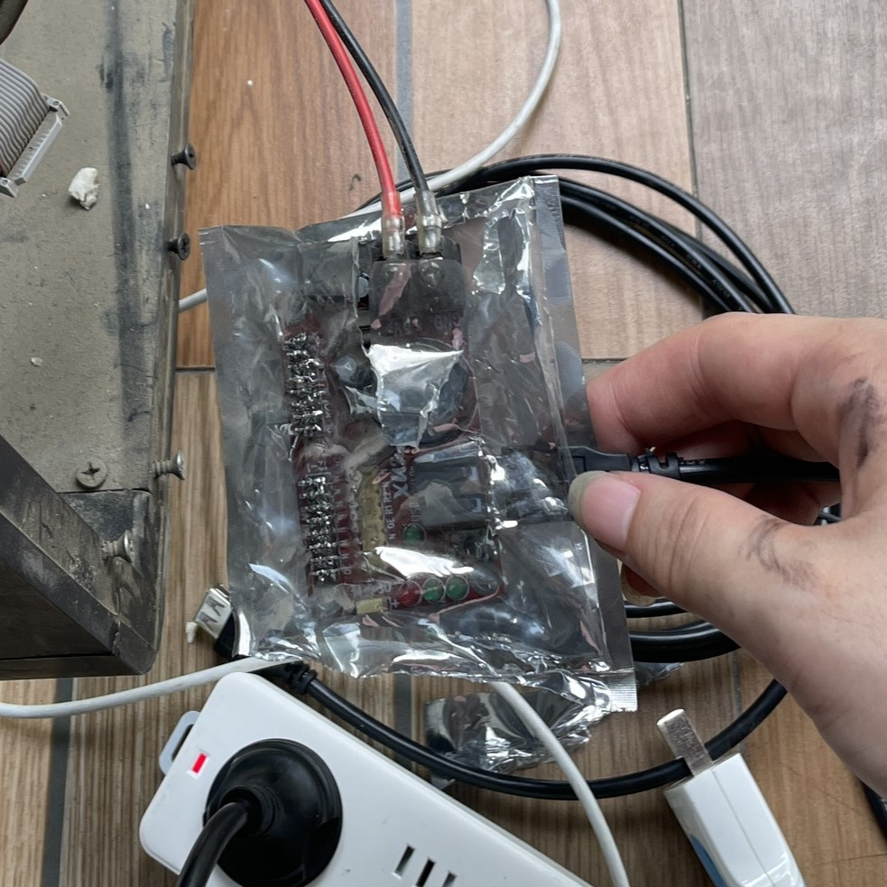
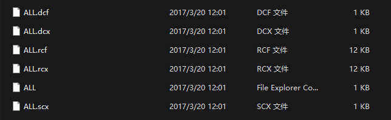
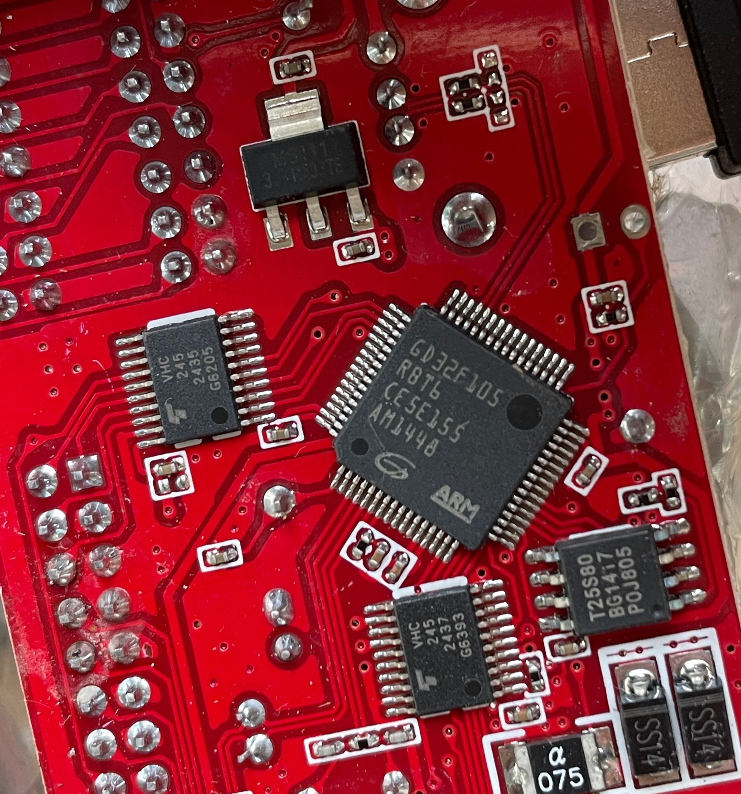
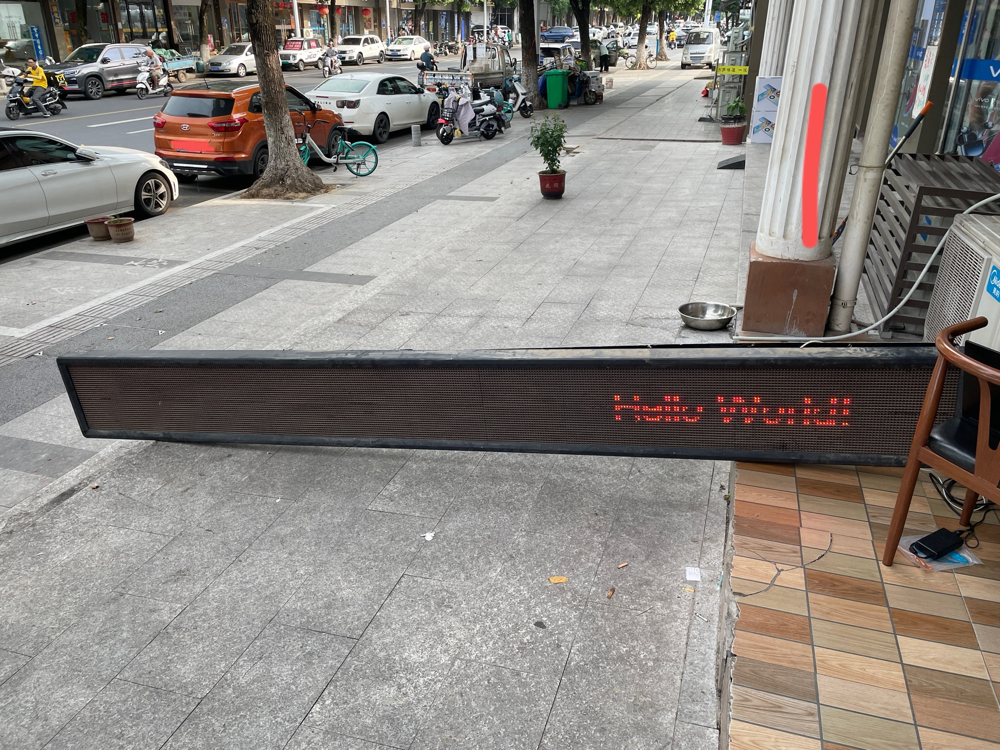

# 20230726 配网吧的LED广告屏

## 网吧重新装修，老广告屏要刷新字幕，于是23号我去看了一下。

## 拆开泡沫后盖，发现控制卡的静电袋还没有去除
可能是为了防水防尘防短路。

经过一番折腾，我发现这个控制卡不能用串口连接。找到一个旧U盘，保存里面数据，格式化之后插入控制卡，得到一个文件ALL.cix，大概内容如下：

XU2  
V5.30  
20150324173057  
53610524030000050004000100040001  

这下明白显示卡的型号时XU2，版本号是V5.30. 2015的时间也对应了网吧第一次装修。经过查询，这卡只能用U盘连接。

## 发现老U盘就是当年刷字幕用的
2017年网吧第二次装修最后一次刷了字，而U盘里原来的文件正好对应这个时间段，这让我不得不怀疑这就是当年用来刷字的U盘。 

果不其然，我恢复里面的文件插入控制卡，重现了当年的字幕。这简直是太巧了。

## 我尝试了多个LED字幕文件生成软件，最后锁定到 X Show
因为这款卡太老了，很多新生软件都不兼容，或者不支持X2系列的控制卡。
老U盘里面文件的后缀名给了我很大启发。在尝试到了多个软件之后，我发现X Show是唯一一个能够生成对应文件的软件。于是成功刷进了字幕。  
在尝试中有一次因为文件不对把控制卡程序卡飞，当时急了把静电袋撕开，看到了熟悉的GD32F单片机。后来是长按了控制卡上的RESET键，才恢复了正常。  

这是更新字幕后的样子，终于大功告成了。

## 最后，广告屏尺寸一定要数对，否侧字幕异常
一块单独LED的尺寸是高16（个LED），宽32（个LED）。
